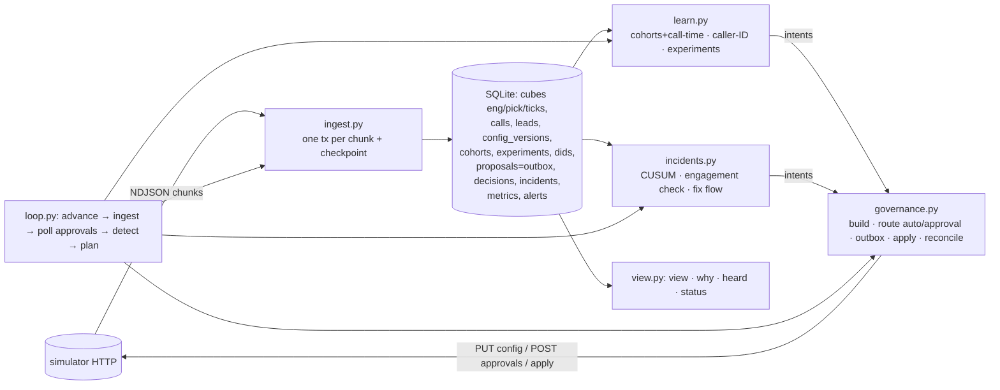

# Outcome-First Agent Loop — Submission

**Name:** Saksham Goyal · **Date:** 2026-11-09 · **Hours actually spent (be honest):** _fill in_ ·
**Language / storage:** Python ≥3.10 (stdlib + `httpx`, already in requirements) / one SQLite file (WAL)

---

## 0. TL;DR
- A single-process controller (`./run.sh URL`) that learns only from **randomised, realised calls**. It spreads traffic across caller IDs and rotates bad ones, schedules call hours per cohort, tests welcome × voice with an 80/20 holdout for decay, and fixes hallucinating or engagement-killing prompts with validation evidence. It sends **one bundled request per workflow per day** at approver open, and explains every change from its own store (`python -m controller why`).
- **public_01:** conclusion rate **+12.4%** vs baseline (pickup +8.2%, engagement +2.8%), 14 changes, **0 harmful**.
- **public_02:** **+28.1%** (pickup +24.4%), 27 changes, **0 harmful**. Flagged caller ID off traffic 90 minutes after it went bad; supervisor's hallucinating prompt fixed in **255 min**, 4 credits.
- **public_03 (load):** **+19.4%**, 63 changes, 0 harmful, **0.47 wall-clock minutes per simulated day**, 345 MB RSS. Survives 8 random `kill -9`s with an identical outcome. Measured false-winner rate: 2 in 42 A/A experiments.
- **Didn't build:** per-person call time, proactive prompt optimisation, fair-share across tenants (one rule only), a web UI (CLI screen instead).

## 1. Assumptions
1. Guardrail `*_max_drop` values are **absolute** rate points (0.02 = 2 pp).
2. Memo preferences that are *stricter* than the API policy are honoured as soft limits. Kestrel gets ≤ 2 routine requests a day and nothing before 11:00 (`cfg.TENANT_PREFS`). Safety incidents may exceed courtesy limits, but **never policy limits**.
3. The client agreement "operational changes may be auto-applied" only applies where the API policy allows it. The API policy wins over any memo.
4. History is the default config only. It's evidence for hour × feature pickup, caller-ID baselines and hallucination baselines, and **never** for variant effects.
5. `hallucination_flag` is a noisy detector with unknown false-positive/false-negative rates. Baselines are per workflow, from history.
6. Engagement is measured per connected call. Repeat attempts on the same lead are treated as independent (a mild violation).
7. A winner is promoted within its own workflow only (Product memo).
8. The approver's judgement rejections are independent per request, so a protective change may be re-asked the same day.
9. The grader box has Python ≥ 3.10 and `requirements.txt` installed (the simulator needs it too). `run.sh` installs it if `httpx` is missing.
10. "Approved by" in the audit means the workflow's client approver. The simulator exposes no approver name, so we record the approval ID and decision time.

## 2. Scope decisions
| # | Capability | Built / Partial / Cut | Why | What it would take to finish |
|---|---|---|---|---|
| C1 | Ingestion at load scale | **Built** | Everything depends on it | Stream consumer + Postgres at 10× (§8) |
| C2 | Lead joins + one shared cohort object | **Built** | Product non-negotiable | Cohort editor/retirement UI |
| C3 | Bootstrapping from history | **Built (narrow)** | Baselines and call-time only; history has no variant data | — |
| C4 | Call-time optimisation | **Partial: per cohort** | Per-person data is ~2 connects per person; noise | Person-level randomised test (§5) |
| C5 | Caller-ID health | **Built** | Biggest pickup lever; graded incident | Re-probe of truly flagged IDs with an explicit risk budget |
| C6 | Welcome × voice experiments | **Built** | Core engagement lever | Hierarchical per-cohort model |
| C7 | Promotion, decay, rollback | **Built** | Graded | Change-point model instead of window tests |
| C8 | Hallucination incident response | **Built** (+ engagement incident) | Graded MTTR; compliance | — |
| C9 | Governance client | **Built** | Graded hygiene; crash safety lives here | Approver-specific latency learning |
| C10 | Impact, affected leads, dry run | **Built (simple, honest)** | Required fields; Product ranks by impact | Calibration study of impact vs realised |
| C11 | Supervisor view | **Partial: one CLI screen** | Kestrel ops supervisor's "one screen"; no frontend to maintain | Serve the same text over HTTP |
| C12 | Audit store | **Built** | Floor; review | — |
| C13 | Crash recovery demo | **Built** | SRE non-negotiable | — |
| C14 | Loop observability | **Partial** | `status` command, metrics + alerts tables | Prometheus exporter |
| C15 | Fair credits / attention | **Cut (one rule)** | Credits only spent on incidents; ≤ 25 per incident | Per-tenant budgets and a queue |

**Principle:** build what is graded on hidden scenarios, or what is required so a hard constraint is never broken. Everything else gets the cheapest *honest* version. Each cut has a reply ready (§3).

## 3. Stakeholders

### 01 — Sales (Nikhil)
- **Accepted:** a lift number per client, shown as conclusions per lead with pickup and engagement **beside** it (`view` shows today vs yesterday).
- **Declined:** a blended score (Product forbids it); "live for everyone by evening" (a lunchtime "winner" at these volumes is noise, see §1.2 of PLAN); rolling out the persuasive prompt.
- **Wrong against the contract:**
  - Kestrel's auto-apply does *not* cover everything: `prompt_version` and `cohorts` are excluded, and `max_shift` is 0.2.
  - Northwind KYC has `auto_apply.enabled: false`.
  - P4 isn't in KYC's options. In priv_incidents a P4-like prompt hallucinated ~2.5× baseline, and validation alone can pass it (failure rate ≈ 0.9·halluc + 0.005 sits near the 0.97 gate).
- **Reply:**
  > Nikhil — you'll have one lift number per client: conclusions per lead (+12–28% on our test scenarios), with pickup and engagement beside it. Product won't let us blend them, and our regulated clients wouldn't trust a blended score. On speed: we promote as soon as the evidence clears, usually in 2–4 days. A lunchtime "winner" is usually noise. Two corrections: Kestrel's auto-apply excludes prompts and caps each step at 20%, and Northwind KYC has auto-apply off, so those changes go to their approvers in one daily request. The persuasive prompt hallucinates far more, so I won't roll it out. Happy to build the summit slide from real numbers.

### 02 — Northwind Compliance (Meera)
- **Accepted, all five:**
  - Customer-facing changes (welcome, voice, prompt) **always** go through approval, even where policy would allow auto-apply (`auto_eligible: False` on explore/promote).
  - Prompt changes carry `validation_run_id` plus live verification.
  - `heard --person` answers the auditor's question in seconds, not 24 hours.
  - Requests go out only at approver open (10:00; KYC 10:00–18:00), never at night (§6).
- **Wrong:** the operational latitude exists for **renewal only**. `nw_kyc` has auto-apply disabled, so even caller-ID or timing changes there go to the KYC approver.
- **Reply:**
  > Meera — agreed on all five. Opening line, voice and script changes always go to your approvers with a dry run and evidence. Script changes carry a validation run and are checked live for hallucination *and* engagement after they go in. One correction: the operational latitude covers renewal only. KYC has auto-apply off, so even caller-ID or timing changes there go to your KYC approver (10:00–18:00). For any customer we can show which opening, voice, caller ID and script they heard on each call, the config version, and why it was live, in minutes. Auto-applied operational changes are listed in your weekly summary.

### 03 — Platform & SRE (Kabir)
- **Accepted:**
  - Kill/restart test: `scripts/crash_test.sh`, 8× `kill -9`, all checks PASS (§9).
  - Idempotency: outbox plus deterministic proposal IDs.
  - No new stateful infrastructure: one SQLite file that maps onto the existing Postgres.
  - Loop health via `python -m controller status`.
  - Load target met: 0.47 min per simulated day.
  - Paging list in `docs/RUNBOOK.md`.
- **Pushed back:** nothing. The 10× analysis is in §8.
- **Reply:**
  > Kabir — kill/restart is proven: `scripts/crash_test.sh` kills the controller 8 times at random. It finishes with every event ingested exactly once, no change applied twice, no approval lost or lapsed, and the same outcome as an uninterrupted run. No new infra: one SQLite file locally, which maps onto your Postgres; no Redis. On public_03: 0.47 wall-clock minutes per simulated day, peak 345 MB, p95 decision lag 0.9 s. At 10×, single-writer ingestion and the per-call audit table break first. The fix is sharding by workflow, since only credits are shared. The on-call runbook and paging list are in `docs/RUNBOOK.md`.

### 04 — Kestrel Ops Supervisor (Anita)
- **Accepted:**
  - ≤ 2 routine requests a day, none before 11:00, everything bundled into one request (§6).
  - Her prompt edits are never undone silently. A problem triggers a request *to her* with numbers. A supervisor's choice permanently ends our experiment on that dimension.
  - One screen (`view`).
  - The strict-script trap is now an incident type: after any prompt change, engagement is compared with before. In priv_incidents a P5 edit was caught and reverted the same day.
- **Pushed back:** a safety incident may add requests beyond the two. On public_02 D3 Kestrel saw 4: two bundles (one re-asked after her own edit made it stale) and two hallucination-fix requests.
- **Wrong-ish:** the policy allows 4/day from 10:00. We honour her stricter ask anyway.
- **Reply:**
  > Anita — done: at most two routine requests a day, never before 11:00, each one bundling everything with a one-line reason per item. Customer-facing changes always come to you first, even where your policy would let us auto-apply them. Your prompt edits stay unless the data shows a problem. Then you get a request with the numbers (e.g. "flags 5.8% vs 1.5%"), never a silent revert. Exception: a hallucination spike can add a request outside the two. Your screen shows what's being tested, what's winning, what we need from you and what changed today. And a "safer" script that empties calls is now caught within hours.

### 05 — Product (Tara)
- **Accepted:**
  - Separate KPIs.
  - One cohort registry (`cohorts` table = config cohorts = view).
  - Proposals carry impact, diff, affected leads and dry run.
  - Expired = rejected and rebuilt fresh (never resubmitted). Realised-only evidence (arms counted from the call's `variant`, stratified by config version).
  - Winners are workflow-scoped.
- **Minimum cohort size:** sized in **connected calls, not %** (§5). Cost table:

  | true lift | n/arm (one-sided α=.02, power .8) | days at a 10% arm share (renewal) | at 25% ("promising") |
  |---|---|---|---|
  | 10% | 1,370 | ~14 | ~6 |
  | 15% | 610 | ~6.5 | ~2.5 |
  | 20% | 343 | ~3.5 | ~1.5 |

  Measured cost of being faster: 2 false winners in 42 A/A experiments (`reports/aa_false_winners.md`).

  That's why promising arms earn up to 25%.
- **Pushed back:** three P0s. Caller-ID health is built (it's the biggest lever, +24% pickup on public_02). The supervisor view is one screen. Per-person call time is cut in favour of per-cohort.
- **Reply:**
  > Tara — all your definitions hold: separate KPIs, one cohort registry used everywhere, expired = rejected and rebuilt from fresh data, and only traffic that actually ran counts. Cohort size is set in connected calls, not %. Detecting a 15% effect takes ~600 calls per arm, about 3–6 days at a safe exploration share; table attached with the speed vs false-winner trade-off. Of your three P0s: caller-ID health is built and is the biggest lever we found; the supervisor view is one screen; per-person call time is per-cohort for now. A person gets about two connects, which is too few to learn from honestly. I've written up the randomised per-person design for when we have the volume.

### 06 — CTO (Aryamann)
- **Accepted:** depth over breadth. Credits are spent only where they change a decision: known-good revert first, LLM only when no known-good prompt exists. On public_02 the whole incident cost 4 credits. Honest weaknesses are in §13; the runbook is written for the person paged.
- **Reply:**
  > Aryamann — I chose depth: caller-ID health, welcome/voice experiments with holdouts to catch decay, prompt incidents (hallucination *and* engagement), governance with an outbox, and an audit trail anyone can query. I cut fair-share allocation (one rule only), per-person call time and proactive prompt tuning. I also said no to a blended score and to auto-promoting a hallucination-prone prompt. Credits: 4 used on public_02, 0 on load. The LLM only runs when no known-good prompt exists. At 10×, single-writer ingestion and the per-call audit table break first; the plan is to shard by workflow on the existing Postgres. The runbook is in `docs/RUNBOOK.md`.

## 4. Architecture

- **State:** all of it is in `state/<scenario>.db`. In-memory caches (the lead → features join for dialable campaigns, config cache) are rebuilt on start.
- **Restart:**
  1. A new simulator world is detected and the old store is set aside.
  2. Every non-final proposal is reconciled against `/approvals` and config history.
  3. Ingestion resumes from the last committed chunk.
- **Loop:** 15-minute ticks while any dialling window or approver window is open; one jump across the night.

## 5. The learning loop
- **Cohorts.**
  - Chosen **from history**: for each lead feature, a chi-square test of (level × hour) pickup interaction. The most significant feature wins (age_band on all public scenarios, z≈10), then levels with similar hourly profiles are merged until ≤ 4 groups with ≥ 12% of dials each.
  - The largest group stays `default`. Adoption is a **zero-behaviour-change proposal** (cohorts plus schedule, allocations untouched).
  - Analysis always runs on raw lead features in the cube, so cohort changes never invalidate data.
  - **Minimum size** is set in connected calls: `n_req(δ, α) × arms / window_days`. At dev volume only workflow-level effects and ≥ 20% cohort effects are detectable; at load volume (16k leads/day) cohort-level promotions happen (e.g. V3 for 60+ on renewal).
  - Fragmentation is avoided with one feature per cohort set, ≤ 4 cohorts, and cohort tests in their own Holm family.
- **Experiment design.**
  - Welcome and voice are sampled independently per dial, so one change tests **both at full traffic** (a factorial design for free). Main effects are estimated by marginalising the other dimension. Interaction is assumed small; it's checkable from the cube but not acted on (see §13).
  - **Harm budget:** a challenger gets ≤ 10% and all challengers together ≤ 20%. A ×0.88 arm then costs ≤ 1.2% engagement for at most a day.
  - **Adaptive:** arms with z ≥ 1 on ≥ 200 calls *and* a positive lift over the last 2 days earn up to 25% (cap 60%).
  - **Pruning:** arms with z < −1 overall, or z < −1 over the last 2 days (an arm that decays while still being explored), are pruned; moving traffic back to the incumbent is always safe. After 6 days, arms with z < 0.5 are pruned.
- **Deciding a winner.**
  - Stratified difference in proportions, with strata = (day, cohort, **config version**). The version stratum fixes a real Simpson's-paradox bug: a mid-day allocation change put the holdout's dials in the morning.
  - Daily looks only, one-sided α = 0.02 per look, family-wise (Holm) within two families (workflow-level and cohort-level). About 5 looks per experiment gives ~0.1 overall.
  - Additional requirements: n ≥ 400, lift ≥ 3%, pickup guardrail OK, and **still ahead over the last 2 days** (novelty guard).
  - Deterministic: no sampling anywhere. The LLM never takes part.
  - **False-winner rate, measured:** across 7 A/A worlds (`scripts/aa_suite.sh`): **2 false winners in 42 experiments (4.8%), 0 harmful changes**. Both were in one seed where W2/W3/V2 all looked good against the same unlucky incumbent sample.
  - **How α was chosen:** I started at α = 0.05 / n ≥ 300. The first A/A run showed 2 false winners from daily peeking plus adaptive shares, so I tightened to 0.02 / 400 at about the same lift. The planned 0.01 would need ~16 days for a +10% effect at a 10% arm share, longer than any scenario. A null promotion is neutral, and the holdout plus rollback catches it.
- **Decay and rollback.**
  - A winner gets 80% and the incumbent keeps a **20% holdout**. Without a concurrent control, decay can't be told apart from drift.
  - Rollback when P(lift < 0) > 0.9 over the last 2–3 days, or when the lift is clearly below its promotion-time lift *and* below 0.
  - Rolling back is asymmetric (moving toward known-good), so it's auto-applied where policy allows, otherwise asked for the same day after a rejection.
  - public_02: W3's share fell from 0.79 to 0.15 to 0 on days 4–6 after onset. public_01: W3 was never promoted (it decayed before the evidence cleared) and stayed at its ~10% exploration share.
- **Call time and caller ID.**
  - **Call time:** per-cohort `hour_weights` = (cohort pickup at h / overall pickup at h)², floor 0.2, every window hour present. This is comparative advantage, since capacity is fixed. It's observational and labelled as such. **Per-person cut:** a person gets about 2 connects. The future design randomises preferred hours for half the people and compares, with the interference caveat that capacity is shared.
  - **Caller ID:** per-tick peer comparison (caller IDs are randomised per dial, so the comparison is unbiased).
    - **Flag** at ratio < 0.7, z < −4 over 3h. It runs every tick, hence the high bar. An earlier z-score ignored peer noise and false-flagged; that's fixed.
    - A caller ID carrying > 1.5× its fair *realised* share is **rested** (fatigue) and re-probed after 2 days of near-zero dials.
    - Untested IDs are **probed** one at a time at 4.5%, so a bad one costs < 2% health; all at once where an approval is needed anyway.
    - The steady state spreads load equally over healthy IDs. KYC's one-caller-ID default was its biggest loss (+19–20% pickup on load KYC workflows).
- **Guardrail KPI.**
  - Every arm test also computes the guardrail difference (pickup for engagement-dimension tests).
  - Promotion veto if the point drop exceeds the limit or P(drop > limit) > 0.2.
  - Post-promotion rollback only if confident (z < −2.33). Welcome and voice can't plausibly move pickup, and the check runs daily.
  - A prompt that keeps hallucinations low but drops engagement is caught by the engagement incident (> 8% drop, z < −3, vs the 2 days before).

## 6. Governance
**State machine** (`proposals.status`):
```
draft → submitting ─► pending ─► approved ─► applying ─► applied
            │            ├─► rejected  → protective (rollback/caller-ID/incident): re-ask same day; routine: next day, rebuilt fresh
            │            ├─► expired   → treated as rejected (Product); rebuilt from fresh data, never resubmitted
            │            └─► (base moved) superseded → re-plan same day without touching a supervisor-edited dim
            ├─► (auto) applied | refused 403 (→ approval path, auto paused 6h) | stale 409
            └─► crash with no trace at the simulator → abandoned (never blindly re-sent)
approved ─► lapsed (410)  → alert; should never happen: we poll every tick and apply on sight
```
- **Batching and timing:**
  - One bundle per workflow per day, at `max(approver start, client preference)` (Kestrel 11:00), including every intent: cohorts, schedule, caller IDs, explore, prune, promote, rollback, align.
  - Courtesy cap = min(policy, preference) with one policy slot kept for incidents.
  - Routine bundles are only sent if the *slowest* approver still decides before TTL. Incidents use the median.
  - No non-urgent auto-apply while an approval is open on that workflow, so we never stale our own request.
  - Result: across all scenario runs **0 lapsed, 0 expired, 0 apply conflicts, 0 fatigue rejections** (`reports/scoreboard.md`).
- **Auto-apply vs not:**
  - **Auto:** caller-ID rotation and spreading, prunes, rollbacks and safety stops (moves toward known-good) where policy allows.
  - **Voluntarily via approval even when allowed:** anything that *increases* a customer-facing variant (explore, promote, reallocate up). Reasons: Northwind Compliance #1, the Kestrel supervisor's "tell me before", and the CTO's "explainable beats bigger". Cost: slower ramps on Kestrel.
- **Impact, affected leads, dry run:**
  - `impact_score = clip(Σ intents (LCB80 relative primary-KPI gain × share of traffic moved) / 0.10, 0, 1)`. It uses the **lower confidence bound**, not the point estimate. 1.0 ≈ "+10% primary KPI workflow-wide at 80% confidence". Incidents = 1.0. Pure exploration = 0, honestly.
  - `affected_leads` = still-dialable leads plus tomorrow's batch, restricted to cohorts whose distribution changes. Only new campaigns for `next_campaign_only`.
  - `dry_run` replays the last 3 days of realised calls under old vs new allocation, and lists **arms without evidence** instead of assuming anything.
- **Supervisor edits mid-experiment:**
  - Recorded as a decision. Experiments on edited dimensions end for good, with a cool-down (48h for agent dimensions, 24h otherwise) on proposals touching them.
  - Pending approvals are marked superseded *before* apply (no 409).
  - If our cohort-level overrides would mask the supervisor's new default, the next bundle asks "apply your choice to these cohorts too?". Never a silent pick either way.
  - public_02 D5 15:00 (default voice → V2): the voice experiment was superseded and nothing was re-proposed on voice.

## 7. Incidents
- **Hallucination detector:**
  - One-sided Bernoulli **CUSUM** on the current prompt's flag rate vs the history baseline (R = 3×, h = 11.5, roughly one false alarm per ~10⁵ calls). For 24h after any prompt change h = 7, because a spike is most likely then.
  - It replaced overlapping-window z-tests, which raised one false incident on public_01 and silently changed a prompt.
  - On the A/A and policy scenarios: 0 incidents.
- **Engagement-after-prompt-change detector:** > 8% relative drop and z < −3 vs the 2 days before, sequential until 1,500 calls.
- **Fix choice:**
  1. Candidates = known-good prompts: ≥ 500 live connects, flag rate not elevated (z < 2), engagement ≥ 95% of baseline.
  2. Only if there are none: `/llm/suggest-fixes` (3 credits).
  3. Validate at n = 400 (4 credits). Accept if pass ≥ policy minimum **and** the 90% Wilson lower bound ≥ policy minimum.
  4. Rank by live engagement evidence.
  5. ≤ 25 credits per incident.
- **Verify after apply:** ≥ 300 connected calls under the new prompt. Flags ≤ baseline + 2σ **and** engagement not significantly below baseline; otherwise reopen with the next candidate.
- **public_02 timeline (ks_cancel):**

  | time | event |
  |---|---|
  | D2 10:00 | (hidden) D2 spam-flagged |
  | D2 11:30 | `D2 flagged: 44% of peers, z=-5.1` → auto-apply D1/D3 50/50 (two max_shift steps); D2 share 7.2% on D2, then 0% for the rest of the run |
  | D3 11:30 | supervisor ships P2 (seen at 11:45: `supervisor_edit`, cool-down on prompt) |
  | D3 13:15 | `incident_opened: flags 5.8% on P2 vs 1.5% over 207 calls (CUSUM 7.1 > 7.0)`; P1 validated 0.985 (LB 0.975) = 4 credits |
  | D3 13:30 | request #1 → 14:15 rejected (judgement call, 5% chance) |
  | D3 14:45 | request #2 → 15:45 approved → **applied immediately** |
  | D3 19:00 | `incident_verify: flags 2.2% (limit 2.9%), engagement 50.8% vs 50.1%` → closed |

  **MTTR 255 min**, 4 credits. Hallucinated calls on ks_cancel: 102 vs 348 in the baseline.
- **priv_incidents:** a night-time persuasive prompt (2.5× flags) took ~7 dialling hours to detect (MTTR 38h including the night and approver hours). A strict-script edit was caught by the engagement detector and reverted the same day.

## 8. Scale (public_03_load; `scripts/load_test.sh`, Apple M-series laptop, simulator on the same box)
| metric | value |
|---|---|
| events | 9.74M (5.5M history + 4.2M live) |
| ingest throughput | 78k events/s overall; history ~200k events/s; live slower (it also writes per-call audit rows) |
| decision lag per tick (ingest + decide) | p50 0.39 s, p95 0.87 s, max 24 s (one-off history bootstrap) |
| wall-clock per simulated day | **0.47 min** incl. the simulator's own ~6 s/day; total 166 s for 12 simulated days |
| peak RSS | 345 MB controller, 158 MB simulator |
| store size | 0.93 GB (3.3M call rows dominate) |
| outcome | +19.4% conclusions, 63 changes, 0 harmful |

**What breaks first at 10× (~8M events/day):**
1. **Single-writer ingest plus the per-call audit table.** At ~20–60k events/s live that's 2–7 min per simulated day: still under 10 minutes, but no headroom. The calls table grows ~1.9 GB/day.
2. **The lead → features join** held in memory: ~3 GB at 10×.
3. Planning is O(cube) per workflow and stays cheap.

**Partitioning:** shard by workflow (hash → worker process, each with its own store or Postgres schema). Every decision is per-workflow except credits and tenant fairness, which become a tiny shared table. Calls go to a time-partitioned Postgres table or object storage, keeping cubes only. Ingestion becomes a stream consumer per shard.

## 9. Reliability
- **Method:** `scripts/crash_test.sh` starts public_02, runs `./run.sh` and `kill -9`s it 8 times at random moments (0.4–2.5 s apart, across D0–D10), then lets it finish.
- **Result** (`reports/crash_test.log`), all **PASS**:
  - every event ingested exactly once (324,328 = simulator `last_event_id`)
  - every simulator-side version we caused is recorded in our store
  - no proposal ID applied twice; nothing left in `submitting`/`applying`
  - no approval lost or lapsed
  - **identical outcome to the uninterrupted run** (+28.1%)
- `tests/test_controller.py` also crashes the controller **between `POST /apply` succeeding and our DB write**, restarts, and checks the reconcile records it exactly once.
- **State lost:** none that matters. Lost at most: the tick's metrics row and in-memory caches (rebuilt).
- **Idempotency keys:**
  - `proposal_id = {workflow}-{seq}`, persisted *before* sending.
  - Chunk number is the ingest checkpoint, and `event_id` is the PK of `calls`.
  - `/sim/advance` isn't idempotent, so on a lost response we compare clocks instead of retrying.
- **4xx/5xx handling:**
  - 5xx and transport errors: exponential backoff (≤ 30 s, 8 tries).
  - `409 stale_base_version` → superseded, re-plan.
  - `409 duplicate_proposal_id` → reconcile.
  - `410 lapsed` → record and page.
  - `403 auto_apply_not_permitted` → approval path, auto paused 6h.
  - `402` → stop spending; incident marked failed and paged.
  - `422` → logged with detail and paged as a controller bug.

## 10. Audit & observability
```
$ python -m controller why --wf ks_cancel --at "D3 16:00"
ks_cancel at D3 16:00 was running config v10, applied D3 15:45 by controller_approved
  proposal ks_cancel-00019 (incident) via approval apr_00011
  requested D3 14:45, decided D3 15:45, applied D3 15:45
  what: switch prompt P2 -> P1 (hallucination incident)
  why: [prompt] hallucination flags at 5.8% on P2 vs 1.5% baseline over 207 connected calls. P1 validated 0.985 on n=400 (val_00001); it ran live before with normal hallucination and engagement rates.
  impact 1.0, affected leads 5021
  approved by: the ks_cancel client approver (simulated) — decision apr_00011
  decision trail:
    D3 14:45 propose: approval request: switch prompt P2 -> P1 (hallucination incident)
    D3 15:45 approval_approved: apr_00011 approved
    D3 15:45 applied: v10 via apr_00011: switch prompt P2 -> P1 (hallucination incident)
  evidence in the 24h before:
    D3 11:45 supervisor_edit: supervisor changed ['prompt_version'] (v9); ...
    D3 13:15 incident_opened: hallucination flags 5.8% on P2 vs baseline 1.5% over 207 connected calls (CUSUM 7.1 > 7.0)
    D3 13:15 validation: P1: pass 0.985 on n=400 (90% lower bound 0.975, policy 0.97) -> accept
  what happened next (24h before vs after, or until the next change):
    before: {'dials': 4800, 'pickup': 0.26, 'engagement': 0.488, 'halluc_flag_rate': 0.0312}
    after:  {'dials': 4300, 'pickup': 0.2619, 'engagement': 0.5098, 'halluc_flag_rate': 0.0187}
  next change: v11 at D4 14:30 by controller_approved

$ python -m controller heard --person ks_cancel:p0000005
D3 13:07 ks_cancel cfg v9 cohort age_band:18-30: welcome W1, voice V1, caller D3, prompt P2 -> voicemail; config by supervisor (no proposal)
D3 16:49 ks_cancel cfg v10 cohort age_band:18-30: welcome W1, voice V3, caller D3, prompt P1 -> voicemail; config by controller_approved (ks_cancel-00019)
```
Every rationale is generated from the decision's stored stats snapshot (`decisions.data` holds n, rates, z and test details), so the text and the numbers can't disagree.

**Page:**
- an approved change about to lapse
- hallucination spike (fix flow started) and fix-flow failure
- approval budget exhausted during an incident
- `422` from our own proposal (a bug)
- 4 silent ticks inside a dialling window
- credits below the incident reserve

**Don't page** (morning summary): rejections/expiries (auto re-planned), caller IDs already rotated, KPI drift (drops only, `info`), superseded re-proposals. Details in `docs/RUNBOOK.md`.

## 11. Results
**public_01** (`reports/public_01_dev.md`)

| workflow | conclusion rate | Δ | pickup | Δ | engagement | Δ | engagement gap captured | hallucinated calls (base) |
|---|---|---|---|---|---|---|---|---|
| ks_cancel | 0.390 | +14.1% | 0.262 | +7.0% | 0.516 | +5.0% | 19% | 50 (57) |
| nw_kyc | 0.414 | +12.9% | 0.268 | +10.9% | 0.600 | +0.5% | 6% | 26 (21) |
| nw_renewal | 0.459 | +10.3% | 0.286 | +8.3% | 0.549 | +1.4% | 6% | 47 (54) |
| ALL | 0.418 | +12.4% | 0.271 | +8.2% | 0.544 | +2.8% | 11% | 123 (132) |

14 changes: 6 beneficial, 8 neutral, **0 harmful**. 0 lapsed/expired/conflicts; peak 1 request per 24h per workflow; 0 credits.

**public_02** (`reports/public_02_incidents.md`)

| workflow | conclusion rate | Δ | pickup | Δ | engagement | Δ | engagement gap captured | hallucinated calls (base) |
|---|---|---|---|---|---|---|---|---|
| ks_cancel | 0.373 | +58.3% | 0.254 | +40.5% | 0.500 | +7.0% | 36% | 102 (348) |
| nw_kyc | 0.441 | +18.0% | 0.279 | +19.2% | 0.597 | -1.8% | -1% | 25 (29) |
| nw_renewal | 0.482 | +11.3% | 0.294 | +12.1% | 0.545 | -1.6% | 7% | 63 (54) |
| ALL | 0.424 | +28.1% | 0.273 | +24.4% | 0.536 | +0.7% | 23% | 190 (431) |

27 changes: 11 beneficial, 16 neutral, **0 harmful**. DID incident: flagged share 7.2% on D2, then 0. Prompt MTTR 255 min, 4 credits. W3 decay share by day after onset: 0.25, 0.63, 0.79, **0.15, 0**.

**Interpretation:**
- **Where we helped:** pickup, everywhere. Caller-ID spreading and rotation plus call-time cohorts were the largest and most reliable lever, especially KYC (single caller ID by default) and the ks_cancel incident. Engagement gains came from welcome/voice main effects and, at load volume, cohort-level winners.
- **Where we were harmful:** never on public_01/02/03. Earlier iterations were, and each became a fix:
  - a false hallucination incident: CUSUM now;
  - a false caller-ID flag: peer-noise term in z now;
  - a probe of a spam-flagged caller ID at 8%: 4.5% now;
  - a guardrail "breach" that was Simpson's paradox: config-version strata now;
  - a decaying W3 promoted late: novelty guard and per-look α now.

  On private scenarios:
  - **priv_incidents v9** reverted a hallucinating P4 to P1. The apply-time verdict counts the −4% engagement (P4 converts better while hallucinating ~7× more). That's the right call, and we'd make it again.
  - **priv_opposite** nw_kyc's first exploration hit a −1.0% engagement verdict, exactly at the harm budget's edge.
- **Engagement is slightly negative on public_02 nw_kyc/nw_renewal** (−1.6 to −1.8%) while pickup is +12–19%. Explanation: better caller IDs and call hours bring in more of the people who rarely pick up, and they engage a bit less. The guardrail is on pickup for those workflows, and conclusions rose +11–18%.
- **Gap captured is modest (11–29%).** We deliberately trade it for zero-to-one harmful changes per scenario. The oracle includes cohort-specific winners (e.g. V3 only for 60+), which need far more traffic than dev scenarios give.
- **What I'd change:** learn the decay crossover (change-point on daily lift instead of window tests); a person-level randomised call-time test; reuse evidence across workflows of the same use case as a *prior* (still promoting per workflow only).

Private scenarios (`reports/scoreboard.md`): A/A **+9–13%** (pickup levers only; 2 false winners in 42 experiments, 0 harmful); tighter-policy **+10.5%**; shuffled incidents **+25.4%**; opposite truth **+5.7%**. Zero lapsed, expired or conflicting applies in all of them.

## 12. Trade-offs & rejected alternatives
| Option | Why considered | Why rejected / what instead |
|---|---|---|
| Thompson sampling / bandits | Faster exploitation | Allocation can only change through ~1 approval a day; a posterior-driven allocation is also hard to explain to a compliance head. Successive elimination plus a harm budget instead |
| α=0.01 per test | Fewer false winners | Can't decide within a scenario at safe arm shares. α=0.05 gave 2 false winners in one A/A run, so 0.02/n≥400 instead: 2 in 42 across 7 A/A worlds |
| 100% promotion | Max lift | Can't see decay without a concurrent control; 20% holdout costs ~20% of the lift |
| Overlapping-window hallucination z-test | Simple | Produced a false incident that changed a prompt; CUSUM controls false alarms under continuous monitoring |
| Proactive prompt optimisation (P3) | +3% engagement on the table | One prompt per workflow means no randomised test is possible; pre/post on a regulated script isn't evidence. Prompts change only for incidents |
| Per-person `lead_preferred_hour` | Product/Sales headline | ~2 connects per person; ×6/×0.25 weights shift capacity between people (interference). Per-cohort instead |
| Postgres/Redis now | SRE's existing stack | Zero setup for a single process; schema ports 1:1. Redis isn't needed at all |
| Auto-apply everything allowed (Kestrel) | Speed | Compliance and the Kestrel supervisor's "tell me before"; we only auto-apply moves toward known-good |
| `orjson` | Faster parsing | Not the bottleneck (SQLite writes are); no new dependency to defend |

## 13. Known weaknesses
1. **Decay crossover.** A variant that decays soon after first exposure may never clear the bar (public_01 W3), or may be promoted right at onset and rolled back ~24h later (priv_policy, where governance is slower).
2. **Cohort-specific effects are mostly invisible at dev volume.** Opposite-signed effects (V3 +22% for 60+, −12% for 18–30) net to ~0 at workflow level and get pruned.
3. **Call-time weights are evaluated observationally**, with no randomised control. The predicted gain (+0.9%) is a rough, halved estimate.
4. **Truly flagged caller IDs are never re-probed.** Only "rested" (overloaded) ones are.
5. **Moderate hallucination spikes (~2.5×) take ~7 dialling hours to detect.** Lowering h would raise false reverts of supervisor prompts.
6. **Winner's curse:** promotion-time lift is inflated (e.g. promoted at +13%, true ~+5%). Impact uses the LCB, but the decay rule compares against the inflated number.
7. **Welcome × voice interaction is assumed away**: analysis is main effects.
8. **Routine rejections wait for the next day**, so a 10–15% judgement rejection costs a day of lift.
9. `TENANT_PREFS` (Kestrel 11:00 / 2 per day) is configuration taken from a memo, not something the API tells us.
10. **The dry run's predicted engagement** is a multiplicative workflow-level model. It's honest about missing evidence but crude.
11. **SQLite single writer and the 0.19 GB/day call table** at load scale (§8).

## 14. If this went to production at Formi next month
1. **Week 1:**
   - Port the store to the existing Postgres (same schema; partition `calls` by day).
   - Run the controller in **shadow mode** on 2–3 real workflows: decisions and proposals logged, nothing sent. Compare its proposals with what supervisors actually did.
   - Wire the paging list into the on-call system.
2. **Week 1:** turn on **caller-ID spreading/rotation only** (auto-apply where policy allows). It's the biggest and lowest-risk lever, and fully reversible.
3. **Week 2:**
   - Approval-path bundles for cohorts plus call-time and welcome/voice exploration, on one consenting client. A weekly summary goes to Compliance.
   - Calibrate impact scores against realised lift; measure real approver latency and rejection rates per client.
4. **Week 2:**
   - Hallucination/engagement incident flow live, alerting only at first; switch to auto-propose after a week with no false incidents.
   - Shard by workflow before onboarding the second large tenant.
